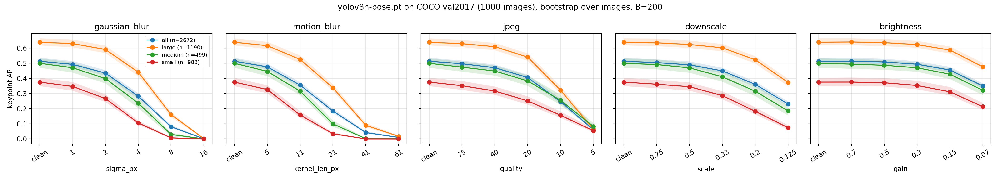
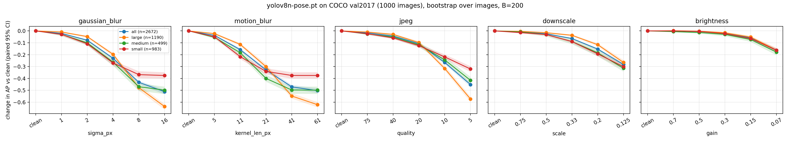
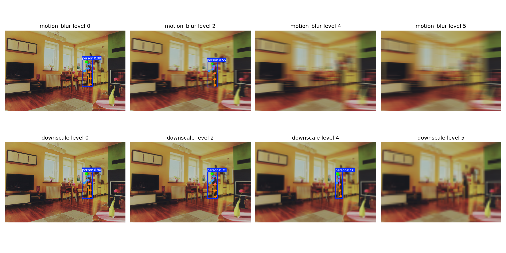

# Robustness of a Pretrained Pose Estimator to Image Degradation

How does the keypoint accuracy of a pretrained pose model (YOLOv8n-pose) degrade under controlled image corruptions, and does it depend on how large the person is in the image? Evaluated on COCO val2017 person keypoints with COCO keypoint AP and paired bootstrap confidence intervals over images.

Motivation: small, blurred, compressed people are the regime of broadcast sports video. This study measures the effect of controlled corruptions on everyday COCO images; it does **not** test sports footage.

## Setup

- **Model:** `yolov8n-pose.pt` (Ultralytics), default inference settings except `conf=0.001`, `iou=0.7`, `max_det=20`.
- **Data:** a random subset of 1,000 COCO val2017 images that contain at least one annotated person with keypoints (2,672 annotated people), seed 0. Because person-free images are dropped, clean AP will not equal the official val2017 protocol; **compare conditions to each other, not to leaderboards.**
- **Corruptions** (applied at native resolution; level 0 = clean): Gaussian blur (sigma 1, 2, 4, 8, 16 px), horizontal motion blur (kernel 5, 11, 21, 41, 61 px), JPEG (quality 75, 40, 20, 10, 5), downscale-then-upscale (0.75, 0.5, 0.33, 0.2, 0.125), darkening (gain 0.7, 0.5, 0.3, 0.15, 0.07). Levels are **not** matched in severity across corruption types, so only compare levels within one corruption.
- **Metric:** COCO keypoint AP (OKS 0.50:0.95), computed per person-size stratum using COCO segmentation area: small 32²-64² px², medium 64²-96² px², large >96² px². The "tiny" stratum (<32² px²) contained **no** annotated people in this subset, so the smallest people are not covered.
- **Uncertainty:** 95% percentile bootstrap over images (B = 200). The same resamples are reused for every condition, so change-versus-clean intervals are paired. The AP implementation reproduces `pycocotools` `COCOeval` exactly on a synthetic test.

## Results

Clean AP: all 0.513 [0.496, 0.535]; small 0.375 [0.348, 0.403] (n = 983); medium 0.499 [0.470, 0.532] (n = 499); large 0.638 [0.617, 0.664] (n = 1,190).

**Keypoint AP retained, as a % of each stratum's own clean AP** (point estimates; the CSV has everything):

| Corruption | Level | Small | Medium | Large | All |
|---|---|---|---|---|---|
| Gaussian blur | sigma 2 | 71.0 | 79.8 | 92.5 | 84.7 |
| | sigma 4 | 28.1 | 47.3 | 69.1 | 55.0 |
| | sigma 8 | 1.8 | 5.9 | 25.1 | 15.6 |
| Motion blur | 11 px | 42.1 | 63.2 | 82.2 | 69.3 |
| | 21 px | 9.1 | 19.9 | 52.8 | 35.9 |
| | 41 px | 0.0 | 0.3 | 14.1 | 8.2 |
| JPEG | quality 20 | 66.9 | 76.7 | 84.6 | 79.0 |
| | quality 10 | 41.7 | 51.1 | 50.4 | 48.1 |
| Downscale | 0.33 | 76.1 | 82.1 | 94.2 | 87.6 |
| | 0.2 | 48.5 | 63.1 | 81.9 | 70.2 |
| Brightness | gain 0.15 | 82.9 | 85.6 | 91.9 | 88.6 |
| | gain 0.07 | 56.7 | 64.3 | 74.6 | 68.1 |

**Observations:**
- At nearly every tested level, small people retain a smaller fraction of their AP than large people (for example Gaussian sigma 4: small retain 28%, large 69%). The exceptions are the near-null brightness gain 0.7 and JPEG quality 5, where AP is close to zero for every size (small 14.5% vs large 10.1%). The absolute change-in-AP plot can look reversed (large people drop more) only because large people start from a higher clean AP; the retained-fraction view is the fair comparison.
- Within the tested ranges, blur (especially horizontal motion blur) and heavy JPEG/downscaling remove most of the AP, while darkening is the mildest: overall AP retained is 68% even at gain 0.07.
- Paired change-in-AP intervals for the "all" stratum are narrow (median width 0.014, maximum 0.039). Darkening at gain 0.7 is indistinguishable from clean (change 0.000, 95% CI [-0.003, 0.003]).

## Limitations

- One model (YOLOv8n-pose), one dataset of everyday scenes, no sports footage, no retraining.
- Synthetic corruptions applied at native image resolution, so a given parameter means different things for images of different sizes.
- Intervals reflect resampling of images only; the corruptions are deterministic and the model is fixed. The retained-fraction numbers above are point estimates without intervals.
- Size strata use COCO segmentation area; the smallest people are absent from the evaluated set.
- The size effect is an association in this data. This study does not identify why small people degrade faster.

## Reproduce

Open `Pose_Robustness_Corruptions.ipynb` in Google Colab (a GPU runtime is faster; CPU also works) and run all cells. It downloads COCO val2017 (about 1 GB), runs all 26 conditions (cached per condition), and writes `robustness_results.csv` and the figures. Ultralytics' code and models have their own license terms (see their repository); model weights are not included here.

## License

Code: MIT (see `LICENSE`). Data: COCO terms apply.
